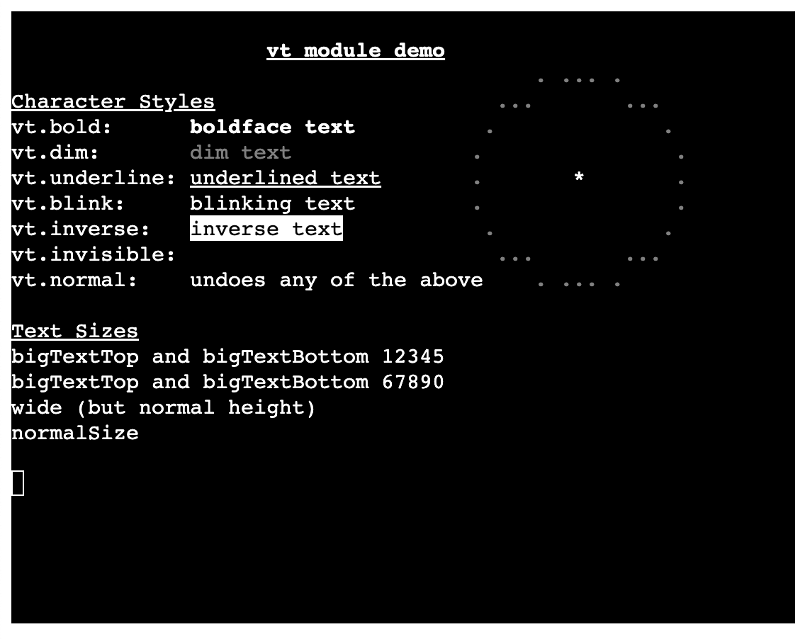

# MiniScript Web-Terminal

MiniScript terminal for the Web.



It allows you to write [MiniScript](https://miniscript.org/) programs that run on a web-terminal. Intrinsics like `print` and `input` interact directly with the terminal. 

The terminal component is [xterm.js](http://xtermjs.org/). As such it supports all [escape sequences](http://xtermjs.org/docs/api/vtfeatures/) that xterm.js is capable of.

The interpreter is [MiniScript 2](https://github.com/JoeStrout/miniscript2), compiled to WebAssembly with [Emscripten](https://emscripten.org/).  It is the same C++ code as command-line MiniScript 2, plus a small web host (`wasm/web_host.cpp`) that supports module `import` (either local modules or "lib" modules).  Included are the [same modules](https://github.com/JoeStrout/miniscript2/tree/main/lib) as command-line MiniScript 2.

(This project was created by [Sebastian Nozzi](https://github.com/sebnozzi/miniscript-web-term), originally running MiniScript 1 via his TypeScript implementation, [miniscript.ts](https://github.com/sebnozzi/miniscript.ts).)

## Usage

First [build from source](#building-from-source).  That gives you an "index.html" page and additional files / folders: the "dist" folder with the terminal and interpreter, and the "lib" folder with command-line MiniScript modules.

Put your MiniScript files directly in the root folder or under a sub-folder of your choice.

Change "data-src-file" in "index.html" (on the "body" element) to point to
the entry file of your program.

For example, if you put it in the root folder it would read:

```html
<body data-src-file="myProgram.ms">
```

And if you put it in a sub-folder it would read:

```html
<body data-src-file="src/myProgram.ms">
```

You can then serve the contents locally (e.g. with `python3 -m http.server 8000`) or zip them and upload somewhere (e.g. to itch.io).

Feel free to explore the [example folder](./example) folder. You might want to remove it before publishing.

## Publishing

In order to "publish" a project (e.g. to [itch.io](https://www.itch.io)) you probably need to create a zip file containing the following:

* index.html
* the "dist/" folder (in particular `miniscript-web-term.js`, `miniscript-web-term.css`, `ms2-engine.js` and `ms2-engine.wasm`; the `.map` files are only for debugging)
* the "lib/" folder (to use built-in modules)
* any other files / folders that your project uses
  (in particular your MiniScript source files)

Remember to adapt "index.html" accordingly.

The page must be served by a web server; it will not work opened directly as a file, since browsers won't load WebAssembly or fetch scripts from `file://` URLs.

## Library modules

`import` looks for a module first next to your entry script, then in the "lib/" folder.

Most modules in "lib/" come from MiniScript 2.  Two are left over from MiniScript 1: `tsv` works, but `dateTime` does not yet, since it relies on an intrinsic (`_dateStr`) that the web host does not provide.

## Terminal Options

You can set / change the terminal options by declaring a (window) global `terminalOptions` variable according to the [ITerminalOptions](https://xtermjs.org/docs/api/terminal/interfaces/iterminaloptions/) and [ITerminalInitOnlyOptions](https://xtermjs.org/docs/api/terminal/interfaces/iterminalinitonlyoptions/) interfaces.

For example:

```javascript
window.terminalOptions = {
  theme: {
    background: "#191A19",
    foreground: "#F5F2E7",
  },
  fontSize: 16,
  cursorStyle: "block"
};
```

The included "index.html" already sets some options, so that you only need to adapt them as needed. 

You can even remove the whole "script" section. In that case the default options will apply.

## Building from source

To build from source make sure you have [Node.js](https://nodejs.org) installed, plus [Emscripten](https://emscripten.org/docs/getting_started/downloads.html) and a clone of [MiniScript 2](https://github.com/JoeStrout/miniscript2) (by default at `../miniscript2`) for the interpreter.

Then from the project's root folder:

```
npm install
npm run build
```

`npm run build` does two steps, which you can also run separately:

- `npm run build-wasm` compiles MiniScript 2's C++ code plus `wasm/web_host.cpp` into `dist/ms2-engine.js` and `dist/ms2-engine.wasm`.  If `emcc` is not on your PATH, set `EMSDK_DIR` to your emsdk folder; set `MS2_DIR` if MiniScript 2 is somewhere other than `../miniscript2`.
- `npm run build-js` bundles the TypeScript front end into `dist/miniscript-web-term.js`.

Once built you can serve the contents locally.

### How it works

The engine never blocks the page.  The TypeScript side (`src/ms2Engine.ts`) runs the program in short time slices, giving the browser a turn between them.  When a script calls `input` or `import`, the engine pauses and asks the page for the line or the module source, then resumes once it has it.  `yield` and `wait` let the page idle until the next animation frame.

## Serve locally

To serve locally, your could use Python's built-in web-server:

```
python3 -m http.server 8000
```

Alternatively you could consider either of these:

* https://www.npmjs.com/package/local-web-server
* https://www.npmjs.com/package/http-server
* https://caddyserver.com/
